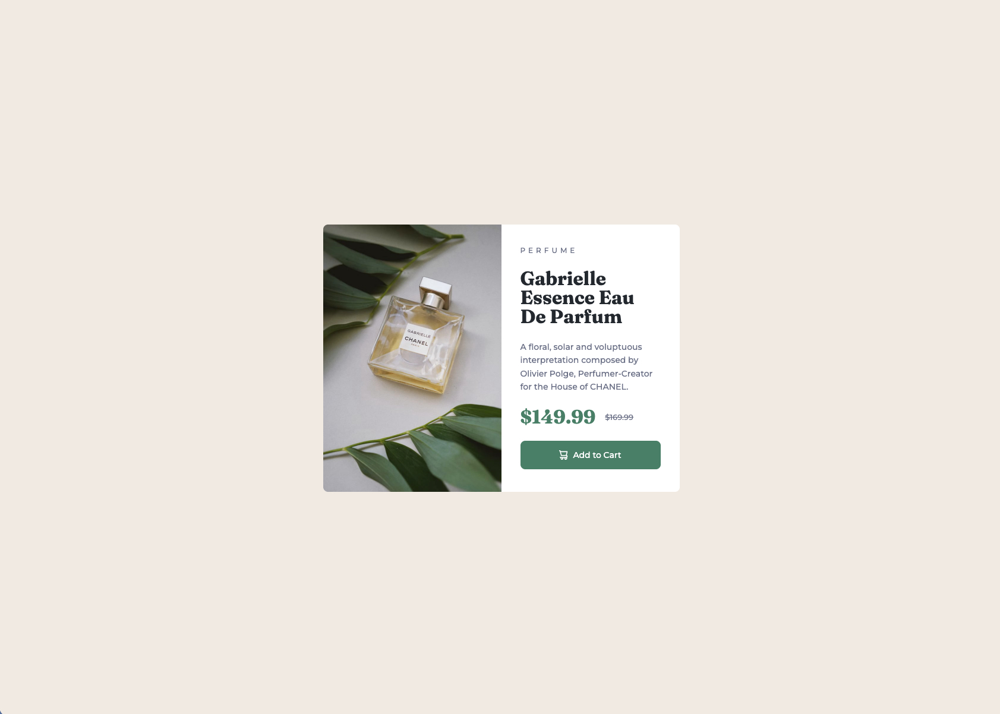

# Frontend Mentor - Product preview card component solution

This is a solution to the [Product preview card component challenge on Frontend Mentor](https://www.frontendmentor.io/challenges/product-preview-card-component-GO7UmttRfa). Frontend Mentor challenges help you improve your coding skills by building realistic projects. 

## Table of contents

- [Overview](#overview)
  - [The challenge](#the-challenge)
  - [Screenshot](#screenshot)
  - [Links](#links)
- [My process](#my-process)
  - [Built with](#built-with)
  - [What I learned](#what-i-learned)
  - [Continued development](#continued-development)

## Overview

### The challenge

Users should be able to:

- View the optimal layout depending on their device's screen size
- See hover and focus states for interactive elements

### Screenshot

### Links

- Solution URL: https://github.com/KingRocko/Product-preview-card-component
- Live Site URL: https://kingrocko.github.io/Product-preview-card-component/

## My process

### Built with

- Semantic HTML5 markup
- CSS custom properties
- Flexbox

### What I learned

- I learned how to use the `<picture>` and `<source>` elements in HTML to display responsive images. These elements allow me to provide different image sources for different screen sizes and choose an appropriate image for each layout.

- Investing time in setting up primitive and semantic CSS custom properties is paying off in the long run. This structure makes my styles easier to understand, reuse, and maintain. It also helps me apply consistent design decisions throughout the project and make changes without having to update individual values in multiple places.

- I explored how Flexbox, `inline-size`, `block-size`, and `object-fit` work together when displaying responsive images. Choosing a suitable approach involves considering both the image and its container, especially when the layout needs to adapt to different screen sizes while preserving the intended proportions and cropping.

– I added hover and focus states to give users clear visual feedback when interacting with the page. Hover states indicate when an element can be clicked, while visible focus states help keyboard users identify the currently selected element. I checked these interactions using both the mouse and keyboard navigation.

– A tricky responsive detail was keeping the image proportions and cropping appropriate as the Flexbox layout changed across screen sizes. I experimented with inline-size, block-size, and object-fit to balance the image dimensions with the surrounding content. Checking the layout at intermediate widths also helped me assess how smoothly it adapted between the mobile and desktop designs.

### Continued development

- I want to deepen my understanding of how Flexbox behaves in responsive layouts, particularly when images are involved. I plan to explore how flex items grow and shrink, how their default minimum sizes affect the layout, and how these behaviors interact with image dimensions. This should help me make more deliberate layout decisions and solve sizing issues with greater confidence.
